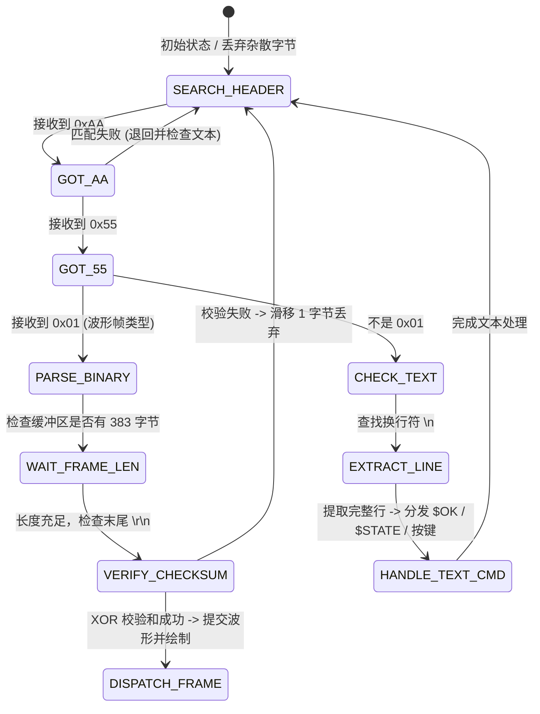

# 远程数据采集系统 通信协议规范手册 (V2.0)
> **适用终端**：显示端（开发板 B / STM32F746 + LCD）、Python 上位机显示模拟器、PC 调试软件  
> **适用对端**：采集端（开发板 A / STM32F746 + LY-AS001 信号源扩展板）  
> **文档版本**：V2.0 (生产发布版，与当前底层驱动 `bsp_protocol.c` 及 Python 模拟器 100% 对齐)

---

## 目录
1. [系统拓扑与物理层配置](#1-系统拓扑与物理层配置)
2. [双模协议架构说明](#2-双模协议架构说明)
3. [下行链路：二进制示波器数据帧协议（采集端 → 显示端）](#3-下行链路二进制示波器数据帧协议采集端--显示端)
   - [3.1 帧结构概览](#31-帧结构概览)
   - [3.2 采样点（Payload）3 字节定义与物理量转换](#32-采样点payload3-字节定义与物理量转换)
   - [3.3 扫描时基档位映射字典](#33-扫描时基档位映射字典)
   - [3.4 异或校验和（XOR Checksum）算法](#34-异或校验和xor-checksum算法)
4. [上行链路：反向控制指令协议（显示端 → 采集端）](#4-上行链路反向控制指令协议显示端--采集端)
   - [4.1 指令格式规范](#41-指令格式规范)
   - [4.2 完整控制指令字典表](#42-完整控制指令字典表)
5. [采集端应答与异步事件通知协议（采集端 → 显示端）](#5-采集端应答与异步事件通知协议采集端--显示端)
   - [5.1 成功确认反馈（$OK）](#51-成功确认反馈ok)
   - [5.2 错误告警反馈（$ERR）](#52-错误告警反馈err)
   - [5.3 全局状态同步应答（$STATE）](#53-全局状态同步应答state)
   - [5.4 板载物理按键异步换挡事件通知](#54-板载物理按键异步换挡事件通知)
   - [5.5 文本调试流输出格式（MODE 0）](#55-文本调试流输出格式mode-0)
6. [显示端（Node B）固件开发与解析实现指南](#6-显示端node-b固件开发与解析实现指南)
   - [6.1 接收流解析有限状态机（FSM）设计](#61-接收流解析有限状态机fsm设计)
   - [6.2 状态机 C 语言工程级参考实现](#62-状态机-c-语言工程级参考实现)
   - [6.3 示波器波形坐标映射与渲染算法](#63-示波器波形坐标映射与渲染算法)
   - [6.4 通信稳定性与抗抖动避坑建议](#64-通信稳定性与抗抖动避坑建议)

---

## 1. 系统拓扑与物理层配置

### 1.1 系统网络拓扑
```
+------------------------------------+             +------------------------------------+
|       采集端 (开发板 A / Node A)    |             |      显示端 (开发板 B / Node B)     |
|   STM32F746 + LY-AS001 信号源板     |   UART串口   |    STM32F746 + 4.3寸 LCD / emWin   |
|                                    | <=========> |               或                   |
| 1. ADC3 双通道逐点同步采样 (CH1/CH2)|  全双工通信  |        PC 端 Python 模拟显示器      |
| 2. 3路数字通道同步采集 (DIG0~DIG2) |             | 1. 5通道波形绘制与刷新 (>=20 FPS)  |
| 3. TIM3 矩形波发生器 (100Hz~10kHz)  |             | 2. 时基/触发/发生器参数触控反控    |
| 4. 示波器硬件边沿触发引擎          |             | 3. 信号自动测量 (Vpp, 频率, 占空比)|
+------------------------------------+             +------------------------------------+
```

### 1.2 物理层与串口参数
* **通信接口**：
  * **PC 调试 / Python 模拟器通信**：板载 ST-Link 虚拟串口 `USART1`（引脚映射：TX=PA9, RX=PB7）。
  * **双板间物理连接**：扩展排针 `USART6`（引脚映射：TX=PC6, RX=PC7，交叉接线：A板TX接B板RX，A板RX接B板TX，共GND地线）。
* **波特率 (Baudrate)**：`115200 bps`
* **数据位 (Data Bits)**：`8`
* **校验位 (Parity)**：`None`（无校验）
* **停止位 (Stop Bits)**：`1`
* **流控制 (Flow Control)**：`None`（无硬件流控）
* **传输编码**：ASCII 文本控制命令 + 紧凑型二进制波形帧

---

## 2. 双模协议架构说明

系统采用**全双工、双模自适应**协议设计：
1. **二进制示波器帧模式（`MODE 1`，系统默认上电模式）**：
   * 采集端将整屏（125点）的双通道模拟量与三路数字通道数据打包为 **383 字节的高效定长二进制帧**。
   * 通信带宽占用约 3.76 KB/s，在 115200 波特率下轻松实现 **25~30 FPS 的流畅高刷**。
2. **文本调试模式（`MODE 0`）**：
   * 采集端以易读的 ASCII 文本格式输出当前测量电压（$V_{\text{CH1}}, V_{\text{CH2}}, V_{\text{pp}}$）、数字通道电平及触发状态。
   * 适合使用普通串口助手（如 XCOM、SSCOM）进行工程排查和手工标定。
3. **反向即时控制**：
   * 无论采集端处于上述哪种模式，显示端均可随时发送 ASCII 控制指令（如 `TB 2\r\n`，`GEN 2000\r\n`），采集端通过硬件中断环形队列无损截获并立即执行，随后返回对应的 `$OK:` 确认反馈。

---

## 3. 下行链路：二进制示波器数据帧协议（采集端 → 显示端）

### 3.1 帧结构概览
当采集端捕获完成一整屏波形数据后，主动向显示端推送一帧标准示波器二进制数据包。

* **单帧固定总长度**：`383 字节`
* **构成公式**：`2字节帧头 + 1字节类型 + 1字节时基 + 1字节点数 + (125点 × 3字节) + 1字节校验和 + 2字节帧尾 = 383 字节`

| 字节偏移 (Offset) | 字段名称 (Field) | 长度 (Bytes) | 格式 / 取值 | 说明 |
| :---: | :---: | :---: | :---: | :--- |
| **0 ~ 1** | **帧头 (Header)** | 2 | `0xAA 0x55` | 固定物理帧同步头，高位在前 |
| **2** | **帧类型 (Type)** | 1 | `0x01` | `0x01` 表示波形示波器数据帧 |
| **3** | **时基档位 (Timebase)** | 1 | `0 ~ 4` | 当前帧采集时所使用的扫描时基索引（见 3.3 节） |
| **4** | **采样点数 (Count)** | 1 | `125` (`0x7D`) | 本帧包含的复合采样点个数（固定为 125 点） |
| **5 ~ 379** | **采样点数据 (Payload)** | 375 | 见 3.2 节 | 125 个采样点，每点占用 3 字节（$125 \times 3 = 375$ 字节） |
| **380** | **校验和 (Checksum)** | 1 | `0x00 ~ 0xFF` | 从 `Type`（偏移 2）到 `Payload` 末尾（偏移 379）的异或累加和 |
| **381 ~ 382** | **帧尾 (Tail)** | 2 | `0x0D 0x0A` | 标准 ASCII 回车换行符 `\r\n` |

---

### 3.2 采样点（Payload）3 字节定义与物理量转换
Payload 包含 125 个依次排列的采样点（时间上从左向右，点 0 到点 124）：
```
Payload = [Point 0 (3B)] + [Point 1 (3B)] + ... + [Point 124 (3B)]
```
每个采样点严格占用 **3 个连续字节**：

| 点内偏移 | 字段名 | 数据类型 | 取值范围 | 对应硬件物理源与含义 |
| :---: | :---: | :---: | :---: | :--- |
| **Byte 0** | `ch1_raw8` | `uint8_t` | `0 ~ 255` | **CH1 模拟通道（电位器）**：ADC3 IN8 (PF10) 采样值（12位压缩至8位） |
| **Byte 1** | `ch2_raw8` | `uint8_t` | `0 ~ 255` | **CH2 模拟通道（麦克风）**：ADC3 IN0 (PA0) 采样值（12位压缩至8位） |
| **Byte 2** | `dig_mask` | `uint8_t` | 位掩码 | **3 路数字通道同步电平掩码**（见下表） |

#### 1. 模拟电压转换公式（CH1 / CH2）
采集端 ADC 参考电压为标准 $3.30\,\text{V}$，显示端解析到 `raw8`（0~255）后，按如下线性公式还原实际物理电压：
$$V_{\text{actual}} = \text{raw8} \times \frac{3.30\,\text{V}}{255.0} \approx \text{raw8} \times 0.012941\,\text{V}$$

* `raw8 = 0` $\rightarrow 0.000\,\text{V}$
* `raw8 = 128` $\rightarrow 1.659\,\text{V}$（麦克风直流静态工作偏置点）
* `raw8 = 255` $\rightarrow 3.300\,\text{V}$

#### 2. 数字通道掩码（`dig_mask`）位映射表
| 位 (Bit) | 掩码名称 | 对应引脚 | 信号源与逻辑电平说明 |
| :---: | :---: | :---: | :--- |
| **bit 0** | `DIG0` | PI0 | **麦克风声音门限电平**：`0` = 检测到音频超过阈值（有效触发）；`1` = 环境静音/低于阈值 |
| **bit 1** | `DIG1` | PF8 | **用户按键状态**：`0` = 按键被按下；`1` = 按键松开释放 |
| **bit 2** | `DIG2` | PI2 | **方波回环通道**：`0` = 低电平（0V）；`1` = 高电平（3.3V） |
| **bit 3~7** | 保留位 | - | 默认填充 0 |

---

### 3.3 扫描时基档位映射字典
帧中 Byte 3 的 `Timebase` 字段取值为 `0 ~ 4`，对应示波器横坐标（时间轴）的分度参数：

| 索引 (TB) | 档位枚举 | 时间分度 (Time/div) | 屏宽总时间 (10 div) | 采样率 (Sampling Rate) | 采样点间隔 ($\Delta t$) |
| :---: | :---: | :---: | :---: | :---: | :---: |
| **`0`** | `TB_10MS` | **10 ms / div** | 100 ms | 5 kSps | **200 µs** |
| **`1`** | `TB_5MS` | **5 ms / div** | 50 ms | 10 kSps | **100 µs** |
| **`2`** | `TB_1MS` | **1 ms / div** | 10 ms | 50 kSps | **20 µs** |
| **`3`** | `TB_500US` | **500 µs / div** | 5 ms | 100 kSps | **10 µs** |
| **`4`** | `TB_100US` | **100 µs / div** | 1 ms | 500 kSps | **2 µs** |

> **提示**：一屏共 125 个点，示波器标准网格通常为 10 大格，即**每大格对应 $12.5$ 个采样点**。采样点 $i$ 相对于触发零点的时间为 $t_i = i \times \Delta t$。

---

### 3.4 异或校验和（XOR Checksum）算法
为了保障数据在长导线或工业现场传输时的完整性，协议引入单字节 XOR 校验和。

#### 计算范围
从帧头后的 **Type（偏移 2）开始，连续异或至 Payload 最后一个字节（偏移 379）结束**，总共计入 378 个字节。

$$\text{Checksum} = \text{Frame}[2] \oplus \text{Frame}[3] \oplus \dots \oplus \text{Frame}[379]$$

#### 算法参考实现 (C 语言)
```c
uint8_t Protocol_CalcChecksum(const uint8_t *frame_buf, uint16_t length)
{
    uint8_t xor_sum = 0;
    /* 校验范围：跳过 0xAA 0x55 两个帧头，直到校验和字段前一位 */
    for (uint16_t i = 2; i < length - 3; i++) {
        xor_sum ^= frame_buf[i];
    }
    return xor_sum;
}
```

#### 算法参考实现 (Python)
```python
def verify_frame_checksum(frame_bytes: bytes) -> bool:
    if len(frame_bytes) != 383:
        return False
    # 异或计算：从第 2 字节 (Type) 到第 379 字节 (Payload 末尾)
    chk = 0
    for b in frame_bytes[2:380]:
        chk ^= b
    return chk == frame_bytes[380]
```

---

## 4. 上行链路：反向控制指令协议（显示端 → 采集端）

### 4.1 指令格式规范
显示端或 PC 向采集端发送控制命令时，采用人类可读、容错性强的标准 ASCII 字符串协议：
* **结束符**：指令必须以回车换行符 `\r\n` 或单一换行符 `\n` 结尾。
* **大小写不敏感**：支持大写或小写（例如 `tb 2\r\n` 与 `TB 2\r\n` 等效）。
* **分隔符容错**：命令与参数之间支持**空格**、**等号 `=`** 或**冒号 `:`**，并自动过滤多余首尾空格（例如 `GEN 2000`、`GEN=2000`、`GEN:2000` 均完全等效）。

---

### 4.2 完整控制指令字典表

| 序号 | 功能分类 | 指令原型 | 参数范围与含义 | 下发报文示例 | 采集端应答反馈 |
| :---: | :--- | :--- | :--- | :--- | :--- |
| **1** | **时基切换** | `TB <index>` | `index`: `0 ~ 4`，对应 5 档扫描时基 | `TB 2\r\n` | `$OK:TB=2\r\n` |
| **2** | **方波发生器测频变频** | `GEN <freq>` | `freq`: `100 ~ 10000` (Hz) | `GEN 2500\r\n` | `$OK:GEN=2500\r\n` |
| **3** | **方波发生器启停** | `GEN_START`<br>`GEN_STOP` | 启动 / 停止 PB4 (TIM3) 矩形波输出 | `GEN_START\r\n`<br>`GEN_STOP\r\n` | `$OK:GEN_START\r\n`<br>`$OK:GEN_STOP\r\n` |
| **4** | **方波预设档位轮换** | `GEN_NEXT`<br>`GEN_PREV` | 依次切换预设档位：<br>`100Hz` $\leftrightarrow$ `500Hz` $\leftrightarrow$ `1kHz` $\leftrightarrow$ `2kHz` $\leftrightarrow$ `5kHz` $\leftrightarrow$ `10kHz` | `GEN_NEXT\r\n` | `$OK:GEN=2000\r\n` |
| **5** | **采集运行 / 暂停** | `RUN`<br>`STOP` | `RUN`: 恢复实时采集并外发波形<br>`STOP`: 冻结采集与波形传输（定格显示） | `RUN\r\n`<br>`STOP\r\n` | `$OK:RUN\r\n`<br>`$OK:STOP\r\n` |
| **6** | **通信协议模式切换** | `MODE <mode>` | `mode`: `1` (二进制波形帧); `0` (文本调试) | `MODE 1\r\n` | `$OK:MODE_BINARY\r\n`<br>或 `$OK:MODE_TEXT\r\n` |
| **7** | **示波器触发模式** | `TRIG_MODE <m>` | `m`: `AUTO` (自动), `NORMAL` (常规), `SINGLE` (单次) | `TRIG_MODE NORMAL\r\n` | `$OK:TRIG_MODE=NORMAL\r\n` |
| **8** | **触发源选择** | `TRIG_SRC <s>` | `s`: `CH1` (电位器), `CH2` (麦克风音频), `DIG2` (方波) | `TRIG_SRC CH2\r\n` | `$OK:TRIG_SRC=CH2\r\n` |
| **9** | **触发边沿选择** | `TRIG_EDGE <e>`| `e`: `RISING` (上升沿), `FALLING` (下降沿) | `TRIG_EDGE RISING\r\n` | `$OK:TRIG_EDGE=RISING\r\n` |
| **10**| **触发电平阈值** | `TRIG_LVL <val>`| `val`: `0 ~ 255` (压缩电压，128 对应 1.65V) | `TRIG_LVL 128\r\n` | `$OK:TRIG_LVL=128\r\n` |
| **11**| **单次触发重新就绪** | `ARM` 或 `SINGLE`| 单次触发模式下重新挂起并等待触发脉冲 | `ARM\r\n` | `$OK:ARM_SINGLE\r\n` |
| **12**| **系统状态同步查询** | `SYNC` 或 `STATUS`| 请求采集端立即回传硬件全套参数状态包 | `SYNC\r\n` | `$STATE,TB:2,MODE:1...` |

---

## 5. 采集端应答与异步事件通知协议（采集端 → 显示端）

采集端在接收并执行显示端命令、或者板载按键状态改变时，会向上推送带有特定前缀的 ASCII 报文。显示端只需根据前缀字符即可轻松完成事件分发：

### 5.1 成功确认反馈（`$OK`）
当控制指令执行成功后，采集端立即返回确认标识，显示端可据此消除 UI 控件的等待状态或提示用户：
* `$OK:TB=<index>\r\n`：时基已生效（例如 `$OK:TB=3`）。
* `$OK:GEN=<freq>\r\n`：方波频率已设置生效（例如 `$OK:GEN=1000`）。
* `$OK:GEN_START\r\n` / `$OK:GEN_STOP\r\n`：方波发生器已使能/已停机。
* `$OK:RUN\r\n` / `$OK:STOP\r\n`：采集已恢复运行 / 采集已冻结暂停。
* `$OK:MODE_BINARY\r\n` / `$OK:MODE_TEXT\r\n`：输出模式已切换。
* `$OK:TRIG_MODE=<AUTO|NORMAL|SINGLE>\r\n`：触发模式已更新。
* `$OK:TRIG_SRC=<CH1|CH2|DIG2>\r\n`：触发源已更新。
* `$OK:TRIG_EDGE=<RISING|FALLING>\r\n`：触发边沿已更新。
* `$OK:TRIG_LVL=<val>\r\n`：触发阈值已更新。
* `$OK:ARM_SINGLE\r\n`：单次触发已重新就绪。

### 5.2 错误告警反馈（`$ERR`）
若指令格式非法或参数超出有效边界，采集端将返回错误码，格式如下：
* `$ERR:TB_RANGE\r\n`：时基索引超出 `0 ~ 4` 边界。
* `$ERR:GEN_RANGE\r\n`：设定频率低于 `100` 或高于 `10000` Hz。
* `$ERR:TRIG_LVL_RANGE\r\n`：触发电平超出 `0 ~ 255`。
* `$ERR:UNKNOWN_CMD:<cmd>\r\n`：无法识别的未知指令。

### 5.3 全局状态同步应答（`$STATE`）
当显示端上电、断线重连或主动发送 `SYNC\r\n` 时，采集端将以一行返回硬件全套运行状态：
```
$STATE,TB:2,MODE:1,GEN:1000,RUN:1,TRIG:CH2,RISING,AUTO,LVL:128,TRGD:1\r\n
```
**键值对含义拆解**：
* `TB:2`：当前时基索引为 2（1ms/div）。
* `MODE:1`：当前输出模式为二进制帧（1=Binary, 0=Text）。
* `GEN:1000`：当前方波发生器设定为 1000 Hz。
* `RUN:1`：当前处于运行状态（1=运行, 0=暂停）。
* `TRIG:CH2,RISING,AUTO`：当前触发源为 CH2 麦克风，上升沿触发，AUTO 自动模式。
* `LVL:128`：触发电平阈值为 128（约 1.65V）。
* `TRGD:1`：最近一帧是否捕获到有效触发边沿（1=触发成功, 0=自由超时走带）。

### 5.4 板载物理按键异步换挡事件通知
当操作者在采集端物理板卡上按下 `PF8`（DIG1 按钮）时，采集端硬件消抖后自动自增时基档位，并向串口广播以下固定特征行：
```
>>> [KEY PRESS] Switched Timebase to [2]: 1ms/div <<<
```
> **显示端处理规范**：显示端在解析文本流时，检测到包含 `[KEY PRESS]`，提取正则 `\[(?P<idx>\d)\]` 获取最新档位索引，**自动联动更新显示屏上的时基下拉框或标签**，无需用户手动刷新！

### 5.5 文本调试流输出格式（`MODE 0`）
当通过 `MODE 0\r\n` 切换到文本调试流时，采集端每采集完一帧将输出格式化数据行（用于串口助手调试）：
```
[1ms/div] Trig:[CH2 RISING AUTO L:128 OK] | CH1:1.650V | CH2:1.648V(Vpp:0.520V) | DIG:[D0:1 D1:1 D2:1] | OVR:0\r\n
```
各字段对应：
* `[1ms/div]`：时基名称。
* `Trig:[...]`：触发源、边沿、模式、阈值以及本次触发是否锁定（OK/WAIT）。
* `CH1:1.650V`：CH1 电位器当前平均直流电压。
* `CH2:1.648V(Vpp:0.520V)`：CH2 麦克风瞬时电压与整屏峰峰值 $V_{\text{pp}}$。
* `DIG:[D0:1 D1:1 D2:1]`：三路数字信号当前逻辑电平（1=高, 0=低）。
* `OVR:0`：ADC 硬件溢出计数器（正常应恒为 0）。

---

## 6. 显示端（Node B）固件开发与解析实现指南

### 6.1 接收流解析有限状态机（FSM）设计
由于二进制波形帧（383 字节）与 ASCII 反馈文本（`$OK:...`、`$STATE:...`）在同一个 UART 物理通道上共存，显示端绝不能采用固定长度直接切分，而应当使用**流式滑动窗口状态机**：



---

### 6.2 状态机 C 语言工程级参考实现
以下代码可直接移植至显示端（开发板 B / STM32F746）工程的串口解析任务中：

```c
#include <stdint.h>
#include <string.h>
#include <stdbool.h>

#define BIN_FRAME_TOTAL_LEN   383
#define ACQ_FRAME_POINTS      125

typedef struct {
    uint8_t  timebase;
    uint8_t  count;
    float    ch1_volts[ACQ_FRAME_POINTS];
    float    ch2_volts[ACQ_FRAME_POINTS];
    uint8_t  dig0[ACQ_FRAME_POINTS];
    uint8_t  dig1[ACQ_FRAME_POINTS];
    uint8_t  dig2[ACQ_FRAME_POINTS];
} ScopeFrame_t;

/* 用户自定义回调接口 */
extern void Display_OnWaveformReady(const ScopeFrame_t *frame);
extern void Display_OnTextLineReceived(const char *text_line);

/* 流式缓冲区 */
#define RX_STREAM_BUF_SIZE    1024
static uint8_t  s_rx_buf[RX_STREAM_BUF_SIZE];
static uint16_t s_rx_len = 0;

/**
 * @brief  将串口中断或 DMA 接收到的数据喂入流解析器
 */
void Protocol_FeedStreamData(const uint8_t *data, uint16_t len)
{
    if (s_rx_len + len > RX_STREAM_BUF_SIZE) {
        /* 防溢出截断：清空一半历史数据 */
        memmove(s_rx_buf, s_rx_buf + (s_rx_len / 2), s_rx_len - (s_rx_len / 2));
        s_rx_len -= (s_rx_len / 2);
    }
    memcpy(s_rx_buf + s_rx_len, data, len);
    s_rx_len += len;

    /* 循环解析当前缓冲区中的所有可能报文 */
    while (s_rx_len > 0)
    {
        /* 1. 尝试匹配二进制示波器帧头: 0xAA 0x55 0x01 */
        if (s_rx_buf[0] == 0xAA) {
            if (s_rx_len < 3) {
                break; /* 等待更多字节 */
            }
            if (s_rx_buf[1] == 0x55 && s_rx_buf[2] == 0x01) {
                if (s_rx_len < BIN_FRAME_TOTAL_LEN) {
                    break; /* 完整帧未到，跳出等待 */
                }

                /* 检查末尾 \r\n */
                if (s_rx_buf[BIN_FRAME_TOTAL_LEN - 2] == 0x0D &&
                    s_rx_buf[BIN_FRAME_TOTAL_LEN - 1] == 0x0A) 
                {
                    /* 检验 XOR 校验和 */
                    uint8_t chk = 0;
                    for (uint16_t i = 2; i < BIN_FRAME_TOTAL_LEN - 3; i++) {
                        chk ^= s_rx_buf[i];
                    }

                    if (chk == s_rx_buf[BIN_FRAME_TOTAL_LEN - 3]) {
                        /* 校验通过，解包并转换数据 */
                        ScopeFrame_t frame;
                        frame.timebase = s_rx_buf[3];
                        frame.count    = s_rx_buf[4];
                        const uint8_t *payload = &s_rx_buf[5];

                        for (uint8_t i = 0; i < frame.count; i++) {
                            frame.ch1_volts[i] = (float)payload[i * 3 + 0] * (3.30f / 255.0f);
                            frame.ch2_volts[i] = (float)payload[i * 3 + 1] * (3.30f / 255.0f);
                            uint8_t dig_m       = payload[i * 3 + 2];
                            frame.dig0[i]       = (dig_m & 0x01) ? 1 : 0;
                            frame.dig1[i]       = (dig_m & 0x02) ? 1 : 0;
                            frame.dig2[i]       = (dig_m & 0x04) ? 1 : 0;
                        }

                        /* 投递至显示渲染模块 */
                        Display_OnWaveformReady(&frame);

                        /* 滑移移出当前处理完毕的帧 */
                        memmove(s_rx_buf, s_rx_buf + BIN_FRAME_TOTAL_LEN, s_rx_len - BIN_FRAME_TOTAL_LEN);
                        s_rx_len -= BIN_FRAME_TOTAL_LEN;
                        continue;
                    }
                }
                /* 校验失败或帧尾不匹配，跳过 1 字节继续同步 */
                memmove(s_rx_buf, s_rx_buf + 1, s_rx_len - 1);
                s_rx_len--;
                continue;
            }
        }

        /* 2. 忽略杂散的前导回车换行或 0x00 */
        if (s_rx_buf[0] == '\r' || s_rx_buf[0] == '\n' || s_rx_buf[0] == 0x00) {
            memmove(s_rx_buf, s_rx_buf + 1, s_rx_len - 1);
            s_rx_len--;
            continue;
        }

        /* 3. 提取以 \n 结尾的 ASCII 文本行 ($OK, $STATE, [KEY PRESS] 等) */
        int newline_idx = -1;
        for (uint16_t i = 0; i < s_rx_len; i++) {
            if (s_rx_buf[i] == '\n') {
                newline_idx = i;
                break;
            }
        }

        if (newline_idx != -1) {
            char line[128];
            uint16_t line_len = (newline_idx < sizeof(line) - 1) ? newline_idx : (sizeof(line) - 1);
            memcpy(line, s_rx_buf, line_len);
            line[line_len] = '\0';

            /* 过滤掉末尾可能存在的 \r */
            if (line_len > 0 && line[line_len - 1] == '\r') {
                line[line_len - 1] = '\0';
            }

            /* 投递文本处理 */
            Display_OnTextLineReceived(line);

            /* 移出已处理的文本行 */
            memmove(s_rx_buf, s_rx_buf + newline_idx + 1, s_rx_len - (newline_idx + 1));
            s_rx_len -= (newline_idx + 1);
            continue;
        }

        /* 若既不是完整二进制帧又暂无完整文本行，保留数据退出等待下一次喂入 */
        break;
    }
}
```

---

### 6.3 示波器波形坐标映射与渲染算法
在开发板 B（4.3寸 480×272 液晶屏）或上位机波形控件中，建议划定波形显示区域（如 `Width = 400 像素`, `Height = 200 像素`）：

1. **水平时间轴（X 坐标）映射**：
   * 一屏包含 $N = 125$ 个采样点。
   * 每个采样点对应的屏幕 X 坐标：
     $$X_i = X_{\text{origin}} + \text{round}\left( i \times \frac{\text{Grid\_Width}}{125 - 1} \right) \quad (i = 0, 1, \dots, 124)$$
2. **垂直电压轴（Y 坐标）映射**：
   * 示波器零电平基准线为 $Y_{\text{baseline}}$（例如屏幕中轴，对应 $1.65\,\text{V}$，或底部对应 $0.00\,\text{V}$）。
   * 屏幕像素坐标向下递增，故物理电压越高，像素 $Y$ 越小：
     $$Y_i = Y_{\text{baseline}} - \text{round}\left( \frac{V_{\text{actual}}}{V_{\text{div}}} \times \text{Pixels\_Per\_Div} \right)$$
   * 若直接采用原始字节 `raw8`（0~255）快速整数运算（无浮点消耗）：
     $$Y_i = Y_{\text{bottom}} - \left( \frac{\text{raw8} \times \text{Wave\_Height\_Pixels}}{255} \right)$$
3. **数字通道（逻辑分析仪式绘制）**：
   * 在模拟波形下方单独开辟 3 条细通道高度（如每通道高 16 像素）。
   * `0` 画在通道底部基线，`1` 画在顶部高电平线，用垂直竖线连接高低跳变沿即可完美再现方波跳变。

---

### 6.4 通信稳定性与抗抖动避坑建议

1. **指令下发间隔保护（防粘包）**：
   * 显示端发送多条连续控制指令时（例如同时发送 `TB 2\r\n` 与 `GEN 2000\r\n`），**两条指令间应保持 $\ge 10\,\text{ms}$ 的微延时**，避免因采集端处理第一条指令时发生 RDR 溢出。
2. **UI 控件防回弹（Optimistic Lock 机制）**：
   * 当用户在显示端触控界面调节下拉框切换时基时，采集端可能恰好推送了旧时基的波形帧。
   * **正确做法**：用户触控改变参数后，显示端记录 `pending_tb = new_tb` 并开启 1.5 秒的锁定宽限期。在此宽限期内，忽略接收帧中的时基强制覆盖，直到接收到 `$OK:TB=<new_tb>` 确认应答后，再解除锁定。
3. **波特率与吞吐量裕量分析**：
   * 115200 波特率下最大理论字节传输率为 $115200 / 10 = 11,520$ 字节/秒。
   * 单帧 383 字节在 25 FPS 时，总数据流量为 $383 \times 25 = 9,575$ 字节/秒，占带宽利用率约 83.1%，**保留了 16.9% 的控制命令与反馈应答安全裕量**。
   * 若双板间需要更高帧率（例如 $\ge 40$ FPS），可将两端 USART 波特率同步提升至 `460800` 或 `921600`。

---

## 7. 附录：快速联调测试用例表

| 序号 | 测试目标 | 显示端下发指令 | 预期采集端串口返回 | 观察物理现象 |
| :---: | :--- | :--- | :--- | :--- |
| 1 | 测试握手与状态获取 | `SYNC\r\n` | `$STATE,TB:2,MODE:1...` | 显示端成功同步采集端当前硬件参数 |
| 2 | 调节时基至 100µs/div | `TB 4\r\n` | `$OK:TB=4\r\n` | 示波器波形迅速展开，显示高频细节 |
| 3 | 方波频率设为 5000Hz | `GEN 5000\r\n` | `$OK:GEN=5000\r\n` | DIG2 数字通道与麦克风测频显示 5000Hz |
| 4 | 暂停波形刷新 | `STOP\r\n` | `$OK:STOP\r\n` | 示波器画面定格静止，可进行光标测量 |
| 5 | 恢复波形刷新 | `RUN\r\n` | `$OK:RUN\r\n` | 示波器波形恢复平滑连续滚动 |
| 6 | 物理按键换挡联动 | （按下 A 板 PF8 按钮）| `>>> [KEY PRESS] ...` | 显示端屏幕上的时基显示自动跳入下一档 |
